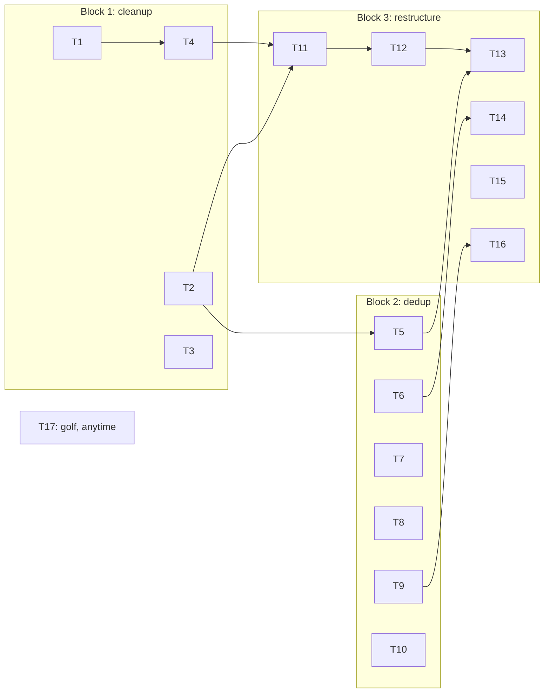

# LeanProofs Refactoring Plan

Refactoring opportunities for the `LeanProofs/` package, organized into
independent, ordered tasks. The goal is a package that is (1) **better
organized** (smaller modules, fewer dependencies), (2) **less redundant**
(shared helpers instead of copy-paste), and (3) **shorter / simpler**
(decomposed and golfed proofs) — **without changing what is proved**.

## How to read this document

- Tasks are labelled `T1`–`T17` and grouped into three execution **blocks**.
- Each task is **independent** unless a `Depends on:` line names a prerequisite.
- Every task records **Benefit**, **Risk**, **Effort**, and a **Verification**
  note for which claims were confirmed against the source at planning time.
- Line and reference counts are heuristic (ripgrep-based) and should be
  re-confirmed at execution time; see [Verification status](#verification-status).

## Invariants every task must preserve

These are non-negotiable. A task that cannot honour all of them should be
abandoned, not forced.

1. **0-sorry / 0-axiom.** The package currently contains **no `sorry` and no
   `axiom`**. No refactor may introduce one, or weaken any theorem statement.
   Every "simplification" must derive the original statement (as a corollary or
   a same-signature wrapper).
2. **Per-operator independence.** The `StepFR{App,Assign,Ite,Deref,NewRef,Seq,`
   `Vlet,Literal,Var,Op,FnPfn}.lean` files MUST NOT import each other. Shared
   helpers go only to `StepFR.lean` (general step machinery) or
   `JoinMemberTransport.lean` (join-member transport), or a *new* module that
   sits below the per-operator layer.
3. **`private` discipline.** Declarations used only within their file stay
   `private`.
4. **Sequential builds.** `lake` builds all transitive dependencies, so files
   sharing a dependency cannot be built concurrently. Authoring of independent
   leaf files may be parallelized, but `lake build` runs serially. Tasks
   touching `StepFR.lean` or `TypeSafety.lean` force a wide rebuild and are
   inherently serial.

## Snapshot

| Metric | Value |
| --- | --- |
| Modules | 34 |
| Total lines | ~107,000 |
| `sorry` / `axiom` | 0 / 0 |
| Largest files | `StepFRApp` 23.9k, `TypeSafety` 19.3k, `StepFR` 14.9k |

The package is structurally sound; problems are **concentrated**, not pervasive:

- **Organization.** `StepFR.lean` (14.9k lines) is an over-broad hub: large
  clusters (closure-application ~2.5k, typecheck-preservation ~4.6k,
  lookup-origin ~1.5k) are consumed mostly by a single downstream file, yet
  every per-operator file recompiles against all of them. `StepFRApp.lean` hosts
  a ~1k-line boundary-contract family that belongs in the boundary layer.
  `FaultRobustnessProofs.lean` inlines a ~1.4k-line `ite` arm that every other
  operator delegates out.
- **Redundancy.** The extern-boundary layer is mirrored along three orthogonal
  axes — `fn`/`pfn`, `Side0`/`Side1` (a.k.a. `run0`/`run1`), and `arrow`/`parrow`
  — producing thousands of near-clone lines. `pfn` extern-declaration machinery
  is copy-pasted across five builtins (~1,150 lines). A 41-line single-run
  skeleton is duplicated across seven per-operator files (and is dead in one).
- **Simplification.** Eight `TypeSafety` strong-induction proofs and four
  `SemanticsProperties` metatheorems repeat identical scaffolds; several
  mega-proofs carry `run0`/`run1` mirror blocks that halve under one
  parameterized lemma.

**Thesis:** harvest verified dead code and `private`/import cleanups first
(near-zero risk), then collapse mechanical mirror duplication (file-local,
mechanical), then attempt hub splits and proof decompositions last (high risk,
build-serializing).

## Task index

Effort: S = small, M = medium, L = large. Theme is shown per-task below.

| ID | Task | Risk | Eff | Depends on |
| --- | --- | --- | --- | --- |
| T1 ✅ | Delete verified dead declarations | low | S | — |
| T2 ✅ | Privatize file-local public decls | low | S | — |
| T3 ✅ | Remove redundant imports; drop empty shell | low | S | — |
| T4 ✅ | Delete dead single-run skeleton (was: hoist) | med | M | T1 |
| T5 | Collapse Side0/Side1 mirror (StepFRApp) | low | M | T2 |
| T6 | Collapse pfn extern-decl machinery | med | L | — |
| T7 | Collapse mirror join helpers (StepFRIte) | low | M | — |
| T8 | Collapse run0/run1 mirrors (mem ops) | med | L | — |
| T9 | Factor arrow/parrow mirrors (JMT) | med | M | — |
| T10 | Factor induction scaffolds (foundations) | high | L | — |
| T11 | Extract closure machinery from hub | med | L | T2, T4 |
| T12 | Extract extern/typecheck clusters from hub | med | L | T2, T11 |
| T13 | Relocate residual hub lemmas + Side family | high | L | T5, T11, T12 |
| T14 | Split ExternProofs per builtin | med | L | T6 |
| T15 | Factor inlined ite arm + boilerplate | med | L | — |
| T16 | Trim JoinMemberTransport | high | L | T9 |
| T17 | Low-risk proof golf (grab-bag) | low | M | — |

## Recommended ordering

Three principles drive the ordering: **zero-risk surface reduction first**, then
**mechanical mirror-collapse**, then **build-serializing structural work**.

**Block 1 (T1–T4): cleanup.** Verified, independent, low-risk surface reduction.
Shrinks the files that later tasks edit and surfaces each module's true API
before the splits.

**Block 2 (T5–T10): mechanical mirror-collapse.** Each task is confined to one
file or the designated shared module, with all public signatures preserved. The
per-operator dedups (T7 on `ite`; T8 on assign/deref/newref) are
mutually-independent leaf files, so authoring can be delegated in parallel even
though `lake` builds run sequentially. T10 touches the deepest foundations and is
its own serial sub-block — its low-risk sub-steps can be pulled earlier, but it
must not overlap a hub split at build time.

**Block 3 (T11–T16): structural restructuring.** T11 → T12 → T13 is a **strict
serial chain** (all edit `StepFR.lean`), sequenced low-to-high risk. T14 (split
`ExternProofs`) depends only on T6 and is otherwise disjoint, so it floats around
the hub block. T15 (`FaultRobustnessProofs` `ite` arm) and T17 (golf) are
independent of the hub and schedulable opportunistically.

---

## Block 1 — zero-risk cleanup

### T1 ✅ — Delete verified dead declarations

**Status: COMPLETED.** All dead declarations and their transitive helpers were
deleted; `lake build` passes with 0 sorry / 0 axiom. Cascade ran 5 rounds deep
(deleting `builtinAbsSpec` orphaned 5 field-lemmas, which cascaded further to
~12 additional helpers including all `builtinAbs*` defs). 1675 declarations
remain; the script's 16 flagged items are capstones or the project-memory–gated
`wfValue_loc_of_RegistryReservedBelow`.

**Theme:** redundancy · **Risk:** low · **Effort:** small · **Deps:** —

**Motivation.** Roughly 700 lines are declarations referenced nowhere, inflating
the most-imported foundations and misleading reviewers about the live API.

**Steps.**

- `FaultRobustness`: delete the `deepVarEnvProperty2` / `deepQTypProperty2`
  mutual block (~57 lines) and the private inductive `wfRegimeForReturn`
  (~12 lines); keep the non-binary `deepVarEnvProperty` / `deepQTypProperty` and
  `wfRegime`.
- `Aux`: delete the dead portion of the `List.Except.Forall2` cluster; keep the
  live `foldlM`, `mapM`, `eraseDups`, `IsSubmap` lemmas. (See caveat — part of
  this cluster *is* live.)
- `ExternRuntime`: delete inductive `ExternBoundaryKind` and simp lemma
  `ofRuntime_unifiedEnv`.
- `ExternTypingAssumptions`: delete `canonical_singleton`,
  `refl_when_respects_vacuous`, `refl_of_empty_mapping`; keep `canonical_general`.
- `ExternRegimeInt`: delete four unused private lemmas; trim stale header bullets.
- `JoinMemberTransport`: delete `agreeValueUnder_clean_monotoneRegime`.
- `StepFR`: delete `agreeValueUnder_same` (+ aux) and
  `valueConsistentWithRegime_transport_pred'`.
- `TypeSafety`: delete `OpEType.sound`, `equiv.refl`, `typecheckIf_standard_etyp'`;
  keep the `…_mk'` lemmas.
- `StepFRNewRef`: delete the dead wrapper `stepFR_newRef`.
- `Semantics`: **do not** touch `wfValue_loc_of_RegistryReservedBelow` without
  user confirmation — project memory marks it a deliberately-kept provability
  witness for a planned val-clause bridge.

**Benefit.** Removes dead code from the most-imported foundations with zero proof
impact.

**Risk.** Pure deletion of provably-dead declarations cannot introduce a
`sorry`/`axiom` or weaken a theorem; a sequential `lake build` catches any missed
fully-qualified reference. The only real risk is *mis-identifying* a live
declaration as dead — mitigated by the re-grep step.

### T2 ✅ — Privatize file-local public declarations

**Status: COMPLETED.** `private` added to 12 `ExternCall*` decls and their `of_*`
constructors in `StepFRApp`, and to the 5 resolver helpers in `ExternBoundaryProofs`
(`resolveDeclaration`, `resolveFnDeclaration`, `resolvePfnDeclaration`,
`TrustedRegistryAgreesWithFnTClosures.resolve`, `TrustedRegistryAgreesWithPFnTClosures.resolve`);
`lake build` passes with 0 sorry / 0 axiom (11466 jobs).

**Theme:** organization · **Risk:** low · **Effort:** small · **Deps:** —
(do after T1 so the deleted `agreeValueUnder_same` is not double-handled)

**Motivation.** CLAUDE.md mandates that declarations used only within their file
be `private`. About 20 verified-zero-external declarations are currently public.

**Steps.**

- `StepFRApp`: add `private` to the 12 zero-external `ExternCall*` decls (the
  `…FRFnSide{0,1}{Contract,Provider}`, `…FRPfnSide{0,1}{Contract,Provider}`,
  `ExternCallFnTypingProvider`, `ExternCallPfnTypingProvider`,
  `ExternCallNoEntryKey`, `ExternCallImpossibleEntryKey`) and their `of_*`
  constructors. Keep `…StaticSource`, `…Single{Fn,Pfn}Contract`, `…EntryKey`,
  and the `…ProgramLocal` names public (consumed by `FaultRobustnessProofs.lean`
  / `CaptureJoinConjunction.lean`).
- `ExternProofs`: `builtinAbsDecl`, `builtinAbsImpl`, `builtinMax11Decl` were
  deleted by T1 (cascade); no work needed here for those names.
- `ExternBoundaryProofs`: add `private` to `resolveDeclaration`,
  `resolveFnDeclaration`, `resolvePfnDeclaration`, and the two `…TClosures`
  resolvers; keep `callBoundaryRun`, `id_eq`, and the `AgreesWithProgram`
  resolvers public.
- `StepFR`: `typecheck_extends_tagMeaning` was deleted by T1 (cascade); no work needed here.

**Benefit.** Shrinks two hubs and the boundary layer's public surface by ~20
names, making the hub splits (T11–T13) safer because each module's API becomes an
accurate map of what is actually exported.

**Risk.** `private` on a zero-external declaration cannot break an external build
by definition; `lake` flags any missed reference. No proof bodies change. Drop the
flag for any decl that turns out to be cross-file.

**Verification.** `ExternCallBoundaryFR*Side*` confirmed at 0 external references
(77 file-local refs).

### T3 ✅ — Remove redundant imports; delete the empty `MemoryMonotonicity` shell

**Status: COMPLETED.** `MemoryMonotonicity.lean` deleted; 7 import edges removed or
redirected: `VarEnvPreservation` moved from `StepFR` to the 4 per-operator consumers
(`StepFRAssign`, `StepFRVlet`, `StepFRIte`, `StepFRApp`); `Equality` dropped from
`StepFR` (still available via `TypeSafety`) and added explicitly to
`JoinMemberTransport`; `ExternRuntime` dropped from `ExternBoundary`; `ExternBoundary`
dropped from `StepFRApp`; `MaxCurriedFR` replaced by direct `ExternProofs` +
`ExternRegimeInt` imports in `GuardedCapturesFR` and `MemReadCapturesFR`. `lake build`
passes with 0 sorry / 0 axiom (11465 jobs; `GuardedCapturesFR` and `MemReadCapturesFR`
now build before `MaxCurriedFR` confirming sibling independence).

**Theme:** organization · **Risk:** low · **Effort:** small · **Deps:** —

**Motivation.** `MemoryMonotonicity.lean` is a **10-line, zero-declaration shell**
(confirmed) imported only by `StepFR`, which already imports
`SemanticsProperties` directly. Several import edges are redundant, and the two
captures-capstones import `MaxCurriedFR` while referencing no `MaxCurried` symbol
in code (only doc-comment prose), falsely chaining three sibling examples.

**Steps.**

- Delete `MemoryMonotonicity.lean` and remove its import from `StepFR` (first
  confirm no `LeanPoison`/`Main` module references the name).
- Move the `VarEnvPreservation` import into the per-operator files that actually
  use it (`StepFRAssign`, `StepFRVlet`, `StepFRIte`, `StepFRApp`) and the
  `Equality` import into `JoinMemberTransport`; then drop both unused re-export
  imports from `StepFR`.
- `ExternBoundary`: drop the redundant `import LeanProofs.ExternRuntime`.
- `StepFRApp`: drop the redundant `import LeanProofs.ExternBoundary`
  (`ExternBoundaryProofs` re-exports it).
- `MemReadCapturesFR` / `GuardedCapturesFR`: replace `import LeanProofs.MaxCurriedFR`
  with imports of `ExternProofs` and `ExternRegimeInt`.

**Benefit.** Removes one dead module and ~6 misleading import edges, decouples the
three FR capstone examples into parallel-buildable siblings, and makes the
documented DAG match reality.

**Risk.** Import bookkeeping only; no declarations move and no statements change.
Each removed edge must be verified transitively provided, and the consumer-side
direct import added in the same change.

### T4 ✅ — Hoist the duplicated single-run skeleton into `StepFR`

**Status: COMPLETED — resolved by deletion, not hoisting.** Closer inspection
showed the skeleton was dead in **all seven** files, not just `StepFRVar`:
`StepFRSingleRunFinalCleanPcTrueWithCtxValCons` and its `_IH` abbrev were never
consumed in App, Assign, Deref, NewRef, Seq, Vlet, or Var (each occurrence was
the def/abbrev itself plus self-references inside the def — no downstream use).
With nothing live to share, hoisting a canonical copy into `StepFR` would have
created a new orphan rather than removing one, so all copies were deleted
outright: 13 declarations removed (7 defs + 6 `_IH` abbrevs; `StepFRVar` carried
only the def), 303 line deletions, 0 insertions. `lake build` passes with 0
sorry / 0 axiom (11465 jobs); per-operator independence is preserved (no shared
def was introduced). A follow-up trim in the same pass removed the unused public
wrapper `TypeSystemEnforcesFaultRobustness_programCovered` from
`FaultRobustnessProofs`.

**Theme:** redundancy · **Risk:** medium · **Effort:** medium · **Deps:** T1

**Motivation.** `StepFRSingleRunFinalCleanPcTrueWithCtxValCons` plus its IH abbrev
(~41 lines) is copy-pasted across **seven** per-operator files (confirmed: 3
references each in App, Assign, Deref, NewRef, Seq, Vlet; the `StepFRVar` copy has
**1** reference — it is dead). The Assign/Var/Deref/Seq/NewRef/Vlet bodies are
byte-identical; `StepFRApp` omits the explicit `registry` field; `StepFRSeq` adds
`RegistryReservedWF` and `ReservedDiscipline` premises.

**Steps.**

- Delete the dead `StepFRVar` copy (can fold into T1).
- Confirm the `StepFRApp` registry-free form is definitionally equal once the
  variable `registry` is in scope; decide whether the `StepFRSeq` stricter variant
  is a separate named def or a parameterization.
- Add one canonical non-`private` def + IH abbrev to `StepFR.lean`; keep the Seq
  variant as a second named def if it cannot unify; delete the remaining copies
  and re-point each file.

**Benefit.** Removes ~250 duplicated lines repo-wide, gives the per-operator files
one shared spec, and eliminates the latent App-variant inconsistency.

**Risk.** Touches `StepFR.lean` (imported by every per-operator file), so the whole
FR stack rebuilds sequentially. The App registry-free and Seq extra-premise
variants must be proven to match the canonical shape before unifying.
Per-operator independence is preserved because the def moves *up* to the shared
module.

---

## Block 2 — mechanical mirror-collapse

### T5 — Collapse the `Side0`/`Side1` two-run extern-call mirror in `StepFRApp`

**Theme:** redundancy · **Risk:** low · **Effort:** medium · **Deps:** T2

**Motivation.** The `ExternCallBoundaryFR{Fn,Pfn}Side{0,1}{Contract,Provider}`
family (~1,264 lines, 77 in-file references, **zero external** — confirmed) is a
pure run-index mirror: `Side0` vs `Side1` Contracts differ in 0 structural lines,
and the `of_trustedReachable` proofs differ in ~6 lines selecting which run is
constrained. Both Sides already forward to a Side-agnostic single-run core.

**Steps.**

- Parametrize the two-run contract and provider over a run selector (`Bool`/`Side`)
  choosing the `run0`/`run1` projection, with the `of_*` discharge family proved
  once; *or* make each `Side` def a thin wrapper that instantiates the run and
  delegates to the existing single-run core, deleting the duplicated `of_*` bodies.
- Keep the four `Side` names (now `private` after T2) as
  abbreviations/specializations so in-file consumers are unaffected; verify the
  `appTwoRunOutChoice_from_independent_*` consumers resolve.

**Benefit.** Collapses ~600 lines of pure subscript-mirror in the
build-cost-dominant file at the lowest risk of the dedup family.

**Risk.** All consumers are within `StepFRApp`; the `Side1` `of_*` proofs are
faithful subscript copies, so parameterization is mechanical and cannot weaken a
statement. Single file, but still a sequential build.

### T6 — Collapse copy-pasted `pfn` extern-decl machinery in `ExternProofs`

**Theme:** redundancy · **Risk:** medium · **Effort:** large · **Deps:** —

**Motivation.** The `pfn` declaration-boundary machinery (`decl_shape`,
`decl_postExpr`, `decl_valueHasETyp`, `decl_valueConsistent`, `declRun_shape`,
`declSingle`, `declFR`) is copy-pasted across **five** `pfn` builtins (confirmed
high repetition: `decl_shape` ×21, `decl_valueConsistent` ×25, `declSingle` ×19,
`declFR` ×23); the Abs and Max10 decl blocks diff to **zero** code lines after
identifier normalization (~230 lines each, ~1,150 total). Six `operationalSafe`
proofs are the identical 14-line "`pfn`-returns-`num`" skeleton.

**Steps.**

- Introduce a generic `private` `pfn`-extern-decl lemma family parametrized over
  `id`, `argName`, `argTyp`, `retSpec`, `memberCap` (the `parrow`-extern
  `resultAgreesIfClean` branch is already `memberCap`-generic). Instantiate each
  of the five `pfn` builtins in ~5 lines.
- Write one `private pfnReturnsNum_operationalSafe` abstracting the `ok_shape`
  witness; discharge all six `operational` fields in ~3 lines each. Verify
  `builtinMax11Impl_operationalSafe` is unused except as the Captures model and
  drop if so. Unify the two `collectAndAllocExternTags_noPred` arities via a
  `List.replicate` induction.

**Benefit.** Removes ~1,150 lines of `pfn`-decl machinery plus ~84 lines of
`operationalSafe` skeleton — the **largest single dedup in the package** —
leaving every trusted-entry `Spec` statement intact.

**Risk.** 0-sorry/0-axiom and all per-builtin `Spec` field statements are
preserved; only proof terms change. `ExternProofs` is mid-DAG with capstone
consumers (sequential build), but the imported `Spec` names are unchanged.

### T7 — Collapse mirror join-consistency helper pairs in `StepFRIte`

**Theme:** redundancy · **Risk:** low · **Effort:** medium · **Deps:** —

**Motivation.** Two left/right join-consistency helper pairs are exact mirror
copies: `consistentWithRegime_join_from_left`/`_right` (144 lines each, zero-line
normalized diff) and `consistentWithRegimeMasked_join_from_left`/`_right`
(148/149 lines, the one-line diff is a stray docstring). `joinRegimes` /
`joinMemEnvsStrong` ship only left/right variants with no commutativity, so the
side-selected facts pass as hypotheses.

**Steps.**

- Extract one ~140-line `private` skeleton for the non-masked pair, parametrized
  over the side via two hypotheses (the `joinRegimes` back-lookup and the
  `joinMemEnvsStrong` `guardClosure` implication); make `…_left`/`…_right`
  two-line wrappers.
- Apply the same treatment to the masked pair, keeping the two **public** theorems
  (`FaultRobustnessProofs` consumers) as thin wrappers. Relocate the stray
  guard-owner docstring to `matchGuard_ok_extract_owner_in_ctx`.

**Benefit.** Removes ~290 lines of left/right mirror within one per-operator file
with no cross-file impact; the two public masked theorems keep their exact
signatures.

**Risk.** Self-contained to `StepFRIte`; the skeletons are identical, so
parameterization is mechanical. Masked wrappers preserve signatures, so
`FaultRobustnessProofs` is untouched. No `JoinMemberTransport`/`StepFR` edit
needed. Parallel-authorable with T8.

### T8 — Collapse `run0`/`run1` mirror blocks in the Assign/Deref/NewRef proofs

**Theme:** redundancy · **Risk:** medium · **Effort:** large · **Deps:** —

**Motivation.** Three memory/assignment mega-proofs each carry a literal
`run0`/`run1` mirror differing only by subscript: the Assign two
`consistentWithRegime` conjuncts (404 lines each, ~800 lines, only 88
mechanically-swapped lines differ); the Deref two `valueConsistentWithRegime`
blocks (~300 lines each); the NewRef two `consistentWithRegime` `hcwr`-final
blocks (~310 lines each, plus a 2-space over-indentation in the `cf1` subtree).

**Steps.**

- **Assign:** first name the repeated memory-update formula (21 spellings) and
  `storedPred` (73 spellings) via `private` defs so both runs reference one
  formula; then extract a `private assign_consistentWithRegime_one_run` and prove
  conjuncts 6 and 7 by applying it twice.
- **Deref:** extract a `private deref_valueConsistentWithRegime_one_run`; consider
  deriving it from the existing masked helper via
  `valueConsistentWithRegimeMasked_unmask` at `masked := false` (the bilateral
  ref-extraction stays in the caller).
- **NewRef:** dedent the `cf1` `some b` subtree by two spaces; extract a
  `private newRef_consistentWithRegime_one_run` covering the general
  `pc`/`guardClosure` case (the masked finish helper assumes `pc = true` and is
  **not** a drop-in; the `pc = false` `guardClosure` subtree is the most intricate
  piece).

**Benefit.** Removes well over 1,000 lines of run-mirror across three files and
fixes a whitespace-standard violation, with each helper local and `private`.

**Risk.** Each extraction has a wide hypothesis surface, so the signature is
fiddly — but the proof text already exists and compiles twice, so the work is
mechanical re-plumbing. No statement changes. Each file is a per-operator leaf
importing only `StepFR`, so independence is preserved. The three files are
mutually independent — author in parallel, build sequentially.

### T9 — Factor the `arrow`/`parrow` mirror families in `JoinMemberTransport`

**Theme:** redundancy · **Risk:** medium · **Effort:** medium · **Deps:** —

**Motivation.** Two `private` lemma pairs are character-identical after
normalizing `arrow`↔`parrow` and `FnTClosure`↔`PFnTClosure`: the internal-poison
pair (205 lines each) and the member-from-member pair (197 lines each), plus the
`joinETyps_preserves_dirty` and `etyp_is` signature pairs. The
`joinMemEnvs`/`joinMemEnvsStrong` `guardClosure` left/right cluster (~247 lines)
is roughly half mirror. All feed the in-file `resultAgreesIfClean` capstone.

**Steps.**

- Introduce one parametrized lemma per pair over a `FunctionShape` discriminator
  (or take an `isArrow`/`isParrow` selector plus the matching
  `joinETyps_preserves_dirty` / `etyp_is_eq` lemmas as hypotheses); derive the
  four `private` names as thin wrappers. Fold the `etyp_is` and `dirty` pairs into
  one shape-generic signature lemma.
- Parametrize the `guardClosure` left/right pairs over a side selector (or add a
  `symm` commutation), keeping the two **public** `…implies_left`/`…implies_right`
  wrappers (`StepFRIte` consumers). Add plain `section` grouping to the flat
  4,309-line file (no namespace, to avoid cross-file qualification changes).

**Benefit.** Removes ~400+ lines of `arrow`/`parrow` mirror plus ~120 lines of
`guardClosure` mirror and adds navigation, behind preserved public signatures.

**Risk.** The collapsed lemmas are `private` and feed only the in-file capstone,
so the public surface and both consumers (App, Ite) are unaffected. The
shape-generic cases must not break the `joinETyps_preserves_dirty` rewrites. Do
this **before** T16 so soon-to-be-merged copies are not relocated first.

### T10 — Factor shared induction scaffolds in the foundations

**Theme:** simplification · **Risk:** high · **Effort:** large · **Deps:** —

**Motivation.** `TypeSafety`'s eight main proofs each re-walk all `Expr`
constructors with the same strong-induction-on-fuel + `cases` scaffold (40
IH-conversion boilerplate occurrences; four-by-eight near-identical literal leaf
arms); four `…of_toPExpr` pure-bridge lemmas share an identical scaffold.
`SemanticsProperties`' four `beval`-recursion metatheorems (~970 lines) repeat one
scaffold with byte-identical literal/extern cases, and four literal `terminatesTo`
inversion helpers are byte-identical (the combined `terminatesTo_literal_inv'`
already exists).

**Steps (do the low-risk sub-steps first; the combinator and bundling are
optional).**

- **`SemanticsProperties` (low risk):** replace the four literal inversion helpers
  with `terminatesTo_literal_inv'` at the two call sites; share the common opening
  of the `bevalFunctionBody` wfConfig lemmas via one prefix helper; add a
  `private` fuel-step lemma to kill the repeated `omega` copies.
- **`TypeSafety` (low risk):** merge the four literal leaf arms per main proof into
  one combined arm; add a `private` fuel-step lemma. Fix the **stale axiom banner**
  (the file is 0-axiom). Relocate or remove the two anonymous "Probe Lemma"
  examples.
- **High-risk optional:** a shared `beval`-success recursion combinator and a
  `P`-parametrized `of_toPExpr` skeleton, preserving all names as projections.
  **Do not** bundle the giant main inductions (see
  [Dropped](#dropped--explicitly-not-recommended)).

**Benefit.** Eliminates an estimated 350–500 lines of duplicated scaffold and leaf
boilerplate across the two most-imported foundations, and fixes a misleading
banner.

**Risk.** These foundations feed the whole FR stack, and the metatheorems are
load-bearing (`beval_nextAddr_mono`, `terminatesTo_nextAddr_mono`,
`wfConfig_preserved`). A generic combinator changes hypothesis shapes inside giant
proofs; **all statements must be preserved (derive originals as corollaries)** to
keep 0-sorry/0-axiom. It is an **isolated serial block** that must not overlap a
hub split at build time.

---

## Block 3 — structural restructuring

### T11 — Extract App-only closure-application machinery out of the hub

**Theme:** organization · **Risk:** medium · **Effort:** large ·
**Deps:** T2, T4

**Motivation.** Of `StepFR`'s ~156 public symbols, ~30 are consumed only by
`StepFRApp` — the bulk being the ~2.5k-line `applyFnTClosure` /
`applyPFnTClosure` / `applyClosuresThreaded` family (all 12 public
`applyClosure`-family lemmas referenced only by `StepFRApp`). An inline comment
near line 12150 (moved from `StepFRApp.lean`) confirms historical accretion.
Editing this machinery currently recompiles all 10 other per-operator files plus
`JoinMemberTransport`, `ExternBoundary`, and `FaultRobustnessProofs`.

**Steps.**

- Create `StepFRClosureApply.lean` importing `StepFR` and imported only by
  `StepFRApp`. Move the `applyClosure` structural family plus the App-only public
  lemmas plus any `private` feeders that become App-only — starting with the
  self-contained ones (`applyClosuresThreaded_ok_mem`, `applyPFnTClosure_mem_subset`,
  `applyPFnTClosure_preserves_memEnv_lookup`, `…_regular_inv`, the
  `closure_body_start` lemmas).
- For lemmas depending on `private` `StepFR` helpers, move the helper *closure*
  with them rather than un-privatizing. Defer extern-origin lemmas to T12 if their
  feeders are the extern-tagMeaning cluster.

**Benefit.** Shrinks the `StepFR` hub by ~2.5k lines so edits to
closure-application machinery no longer rebuild the other 10 per-operator files
and the boundary/orchestration layer — **the single biggest build-decoupling win.**

**Risk.** Pure relocation preserves 0-sorry/0-axiom. The mechanical hazard is the
dense web of `private` `StepFR` helpers these lemmas depend on: move the helper
closure or selectively un-privatize. Per-operator independence is preserved
because the new module is consumed only by `StepFRApp`. First of the hub-split
chain because it is the cleanest cut with the largest decoupling.

### T12 — Extract the extern-tagMeaning + typecheck-preservation clusters

**Theme:** organization · **Risk:** medium · **Effort:** large ·
**Deps:** T2, T11

**Motivation.** `StepFR` holds two large cohesive IH-free clusters depending only
on lower-DAG modules: the extern-tagMeaning cluster (~1,455 lines; a grep for
`StepFR_IH` returns 0) and the typecheck-preserves structural-induction block
(~4,600 lines — the file's longest proofs) plus the lookup-origin cluster
(~1,485 lines). Together that is over half the hub, forcing every per-operator
file to recompile against proofs it does not conceptually need.

**Steps.**

- Move the extern-tagMeaning cluster (`resolveSyntaxPred`, `surfaceSpec`,
  `typecheckExternVal`, `applyFnTClosure_extern`, `applyExternEffect`,
  `forIn_effects` plus the four public origin lemmas) into a new
  `ExternTagMeaning.lean` between `{TypeSafety, ExternRuntime}` and `StepFR`;
  `StepFR` re-imports.
- Move the typecheck-preserves block
  (`joinTypeResults_tagEnvConsistentWithRegime`,
  `typecheckExpr_preserves_regimeConsistentWithCtx` and `…MaskedTagsAbsent`,
  `typecheck_extends_tagMeaning` (now `private` per T2),
  `typecheck_preserves_predSatLaws`, the `StepFRSingleRunTagMeaningPost` wrappers)
  plus the lookup-origin cluster into two modules below `StepFR`.
- Grep each block for `private` helpers shared with residual `StepFR` (the
  near-12150 comment warns some clean-lookup helpers are shared infra) and
  move-or-keep-reachable to avoid a cycle. Stage the extern cluster first, then
  typecheck-preserves, then lookup-origin.

**Benefit.** Removes ~3.5–7.5k lines from the `StepFR` hub and isolates its
heaviest fuel-induction proofs below the per-operator layer, so editing them stops
triggering full-stack rebuilds.

**Risk.** Larger than T11: must move `StepFRSingleRunTagMeaningPost` and a few
`RespectsTagMeaning` helpers shared with the rest of `StepFR`, verifying no
`private` helper is needed by both moved cluster and residual `StepFR` (else a
cycle or duplication). No statement changes. New modules sit below the
per-operator layer, preserving independence.

### T13 — Relocate residual App-only hub lemmas and the Side family

**Theme:** organization · **Risk:** high · **Effort:** large ·
**Deps:** T5, T11, T12

**Motivation.** After the cluster splits, residual App-only `StepFR` public
lemmas still live in the hub (the moved-from-`StepFRApp` legacy), and the ~1k-line
Side family (`StepFRPost`-shaped boundary contracts) architecturally belongs in
the `ExternBoundary`/`ExternBoundaryProofs` layer, not in the App case proof.

**Steps.**

- Move the remaining App-only public `StepFR` lemmas (after T11/T12 have taken the
  closure and extern subsets) down into `StepFRApp`; for any still needing a
  `private` hub feeder, move the feeder too.
- After T5 has collapsed the Side family, relocate the parametrized boundary
  contract(s) into `ExternBoundary`/`ExternBoundaryProofs` (or a dedicated
  `ExternCallBoundarySides.lean` imported by `StepFRApp`), since they are
  boundary-contract definitions used nowhere outside `StepFRApp`. Verify the
  `ExternCallBoundarySingle{Fn,Pfn}Contract` consumers in `StepFRApp` and
  `FaultRobustnessProofs` still resolve with **no definitional-unfolding
  regression**.

**Benefit.** Finishes shrinking the `StepFR` public surface by ~30 names and moves
~1k lines of boundary contracts to the architecturally correct layer, leaving
`StepFRApp` focused on the application-case proof.

**Risk.** Relocating boundary contracts risks changing definitional unfolding that
downstream proofs rely on (the `Single{Fn,Pfn}Contract` consumers) — which could
break proofs *without* adding a `sorry`, and fixing them is non-trivial. Plain
relocation is lower risk than any further merge. Per-operator independence forbids
`StepFRApp` importing a sibling; lemmas move only to App (a leaf) or down to the
boundary layer. **Highest-risk placement task** — last in the hub chain.

### T14 — Split `ExternProofs` along the per-builtin seam

**Theme:** organization · **Risk:** medium · **Effort:** large · **Deps:** T6

**Motivation.** `ExternProofs` is a flat 6.2k-line concatenation of seven
self-contained trusted entries under one namespace; cross-builtin coupling is
near-zero (Max10 and MemDeref reference no other-builtin helper; only Max11Guarded
reuses Max11Captures defs); downstream consumers import only per-entry
`Spec`/`Decl`/`Impl` names. SetErr alone is ~1,777 lines.

**Steps.**

- After T6 has extracted the shared `pfn`-decl and operational helpers, place those
  helpers in one small base module the per-entry files import.
- Carve per-entry files (`ExternProofsAbs`, `ExternProofsMax` keeping the
  curried-max pair together, `ExternProofsMemDeref`, `ExternProofsSetErr`,
  `ExternProofsErrno`), reproducing the `ExternProofs` namespace and the
  `ExternRefDecl` sub-namespace; repoint the downstream imports (`MaxCurriedFR`,
  `ExternRegimeInt`, `GuardedCapturesFR`, `MemReadCapturesFR`); consolidate the
  split `ExternRefDecl` namespace. Preserve all `Spec`/`Decl`/`Impl` names.

**Benefit.** Turns a 6.2k-line monolith into focused per-entry modules sharing a
small base, improving the module-API read and isolating the 1.8k-line SetErr entry.

**Risk.** Mechanically low-risk (the blocks are independent) but touches the import
graph: the `ExternProofs` namespace and `ExternRefDecl` sub-namespace must be
reproduced and downstream imports repointed. Pure relocation preserves
0-sorry/0-axiom. Disjoint from the `StepFR` hub block (separate subtree), so
schedulable around it.

### T15 — Factor the inlined `ite` arm and boilerplate in `FaultRobustnessProofs`

**Theme:** organization · **Risk:** medium · **Effort:** large · **Deps:** —

**Motivation.** `FaultRobustnessProofs` inlines the entire ~1,400-line `ite` arm
of the masked single-run proof, while every other operator delegates in ~15 lines
to a `stepFRSingleRunFinalCleanPcTrue…maskedReg` lemma in its own `StepFR*` file;
`StepFRIte` is the only operator exporting **zero** such lemma. Secondary: a
~95-line contracts hypothesis preamble copy-pasted across 3 theorems; the 4
literal arms are ~27-line near-clones; the 4 extern-declaration arms are a
~28-line near-identical family.

**Steps.**

- Extract the inlined `ite` body into a new
  `stepFRSingleRunFinalCleanPcTrue_ite_maskedReg_with_expr_proof` in
  `StepFRIte.lean` (which imports only `StepFR` and `JoinMemberTransport` — both
  permitted), threading the closed-over locals as explicit parameters; replace the
  inlined arm with a ~20-line delegating arm mirroring the `op`/`seq` arms.
- Bundle the contracts preamble into a `private structure FRCtxContracts` (+ an
  `FRStepContracts` extension) so the 3 theorems project fields; collapse the 4
  literal arms and the 4 extern-declaration arms into one `private` helper each.

**Benefit.** Relocates ~1,380 lines into the topic-appropriate `StepFRIte`
(`FaultRobustnessProofs` ~3,507 → ~2,150 lines; a uniform masked single-run across
all operators) and removes ~250+ lines of preamble/arm boilerplate.

**Risk.** Pure relocation + boilerplate factoring; no statement weakens. The
`ite`-arm extraction closes over many locals that must become explicit parameters
(a signature mismatch fails the build, but the blast radius is `StepFRIte` + the
one call site). The contracts-structure change must reproduce implicit-binder field
types exactly. Independent of the hub block.

### T16 — Trim `JoinMemberTransport` to genuinely-shared lemmas

**Theme:** organization · **Risk:** high · **Effort:** large · **Deps:** T9

**Motivation.** `JoinMemberTransport` exists for lemmas shared by **both**
`StepFRApp` and `StepFRIte`, but 7 of its 12 public lemmas violate that (5
App-only, 2 Ite-only), and several `private` helpers are reachable only from
App-only roots. Some `private` bases are genuinely shared between an App path and
an Ite path and must stay.

**Steps.**

- Move App-only `agreeValueUnder_clean_monotoneRegime_ext` (10 App uses, no
  JMT-private deps) into `StepFRApp` and mark `private`. Move the App-exclusive
  `consistentWithRegime` and masked-transport trio plus their App-only `private`
  helpers into `StepFRApp` — **but keep the `guardClosure` private base in JMT**
  because it is also used by an Ite path; the App-side wrapper imports it.
- Optionally move the two Ite-only public wrappers
  (`joinMemEnvsStrong_lookup_guardClosure_implies_left`/`_right`) to `StepFRIte`
  and privatize, leaving JMT exporting only the shared base.

**Benefit.** Refocuses `JoinMemberTransport` on genuinely-shared transport,
removing ~460 App-exclusive lines from a module justified as App∩Ite shared.

**Risk.** Relocation crosses a shared base: the `guardClosure` private base is
consumed by both an App-only and an Ite-only path, so it must stay in JMT — and
per-operator independence forbids `StepFRApp` importing `StepFRIte`, so any helper
Ite also needs must remain in JMT. Do this only **after** T9 so merged (not
duplicated) lemmas are relocated. High risk due to the shared-base entanglement.

### T17 — Low-risk proof golf and shared-helper extraction (grab-bag)

**Theme:** simplification · **Risk:** low · **Effort:** medium · **Deps:** —

**Motivation.** Several small, self-contained golf opportunities across
otherwise-clean files.

**Steps.**

- **`RegimeConsistency`:** add `private tagEnv_get_insert_of_ne` for the 6 inline
  blocks; consider deriving the non-masked `tagEnv`-insert lemmas from the
  masked ones via the existing unmask bridge; merge the three `lookup_qtyp`
  lemmas; optionally parametrize the four `QTypInQTyp…root_or_self` over closure
  shape (keep the two extern names **public** — `StepFR` consumes them).
- **`FaultRobustness`:** factor the `varsRegime`/`locsRegime` monotone trio's
  shared `withPred_ok` reasoning.
- **`ExternBoundary`:** rewrite the 19 `ExternDeclarationReachableFromExpr`
  navigation theorems as term-mode one-liners (keep `id_eq`).
- **`ExternRegimeInt`:** introduce `emptyCtx_FR_of_agreesWithProgram` and delete
  the four `hagrees` glue theorems.
- **`ExternTypingAssumptions`:** extract the `buildBatchTm` fold-invariant helper.
- **`Equality`:** add a header note that `deriving DecidableEq` is infeasible
  because of the `LocSet`/`ExtTreeSet` field and the `Expr`/`Value` mutual
  recursion (prevents future wasted effort).

**Benefit.** Removes several hundred lines of boilerplate across already-clean
files, documents an infeasible refactor, and tightens trivial proofs behind
preserved public signatures.

**Risk.** Mostly same-file golf with preserved statements, so 0-sorry/0-axiom
holds and consumers are unaffected. The `QTypInQTyp` parametrization and
`buildBatchTm` fold-invariant carry moderate proof-engineering risk; fall back to
the lighter helper extractions if a clean abstraction does not emerge. **Avoid**
the `EffectTarget`/`CaptureTarget` `DecidableEq` change that touches `Syntax.lean`
(a root) unless treated purely additively. Schedulable opportunistically;
splittable per file.

---

## Dropped — explicitly not recommended

These were considered and rejected; recording them prevents re-litigation.

- **Bundle `TypeSafety`'s giant main inductions into conjunctions**
  (`combined_main` style): high risk of case-discharge interactions in the
  structural core feeding the whole FR stack, for modest savings. The leaf-arm and
  step-lemma golf in T10 captures most of the value.
- **Full `fn`/`pfn` unification of the `applyTClosureAtCursor` reachability twins
  and the `StepFRApp` `arrow`/`parrow` lemma families:** rooted in two distinct
  interpreter inductives (`FnTClosure`, `PFnTClosure`) and four separate `apply`
  defs in `LeanPoison` — out of scope for a `LeanProofs`-only refactor, and risks
  breaking definitional reduction (and thus 0-axiom). Only narrow shared-skeleton
  extractions are worth it (folded into T9 and T17).
- **Merge the `var` masked/unmasked consistency lemmas (or any masked/unmasked
  predicate parametrization):** the masked predicate adds a `maskedTag`
  constructor (a distinct inductive family), so a shared abstraction may not exist
  without a generalization rippling through `RegimeConsistency` and every
  consumer. Speculative, high-effort, likely net-negative.
- **Split `TypeSafety`'s 9.3k-line extern-closure structural block / relocate its
  container helpers to `Aux`:** high risk (`TypeSafety` is imported by `StepFR`
  plus 4 others, and the extern lemmas are interleaved with the preservation
  proofs), all-or-nothing rebuild, and the placement is not actively painful.
  Deferred.
- **Merge the three FR capstone files (`MaxCurriedFR`, `MemReadCapturesFR`,
  `GuardedCapturesFR`) into one module:** mutually exclusive with the T3
  sibling-decoupling direction; the per-file documentation has standalone value.
  Decoupled siblings (T3) are preferred.
- **Delete `Semantics.wfValue_loc_of_RegistryReservedBelow` without
  confirmation:** project memory marks it a deliberately-kept provability witness
  for a planned val-clause bridge. Gated on user approval inside T1, not an
  automatic deletion.
- **Split `ExternBoundaryProofs`' reachability engine from the trusted-registry
  resolvers:** the resolvers depend on the engine, so the split must respect that
  direction and yields small net import savings. Lower value than the
  dead-code/private/golf wins already captured.

## Verification status

The aggregate structural and duplication claims were spot-checked against the
source at planning time. Confirmed:

- ✅ `MemoryMonotonicity.lean` is a 10-line, 0-declaration shell imported only by
  `StepFR` (T3).
- ✅ The single-run skeleton was copy-pasted across 7 files (T4). Planning-time
  count read 3 refs each (1 for `StepFRVar`), but on execution those proved to be
  the def/abbrev plus self-references — **all seven copies were dead** and were
  deleted rather than hoisted.
- ✅ The `ExternCallBoundaryFR*Side*` family is file-local — 0 external refs, 77
  in-file (T2, T5).
- ✅ `pfn` extern-decl machinery is heavily repeated in `ExternProofs` (T6) —
  `decl_shape` ×21, `decl_valueConsistent` ×25, `declSingle` ×19, `declFR` ×23.
- ✅ `ExternBoundaryKind` is dead (T1) — 1 occurrence = def only.

**T1 is complete** — the items below were planning-time uncertainties that were
resolved during execution and need no further action:

- `deepVarEnvProperty2`: actual name was `deepVarEnvProperty₂` (Unicode subscript);
  confirmed dead and deleted.
- `agreeValueUnder_same`: the 4 references were all in comments; confirmed dead
  and deleted along with its aux lemma.
- `Aux` `List.Forall2` cluster: per-lemma check done; live members kept, dead
  members (`mapM_Except_ok_implies_forall2`, `exists_of_mem_left`,
  `mapM_Except_ok_exists_of_mem_left`) deleted.

**Takeaway:** the *aggregate* findings (which clusters are duplicated, which
modules are oversized, which families are mirrored) remain reliable for
planning T2–T17.

## Execution notes

- Build **one module at a time** (`make lean-build-file FILE=…`), never
  concurrently across shared-dependency files.
- After each task, confirm the package is still **0-sorry / 0-axiom** and
  **warning-clean** (CLAUDE.md: prefix unused binders with `_`).
- Commit only at green, compiling checkpoints, and only with user approval.
- Block-2 per-operator dedups (T7, T8) and the per-file golf in T17 are safe to
  **author** in parallel sub-agents (the files are mutually independent), but
  their `lake` builds must still be serialized.
